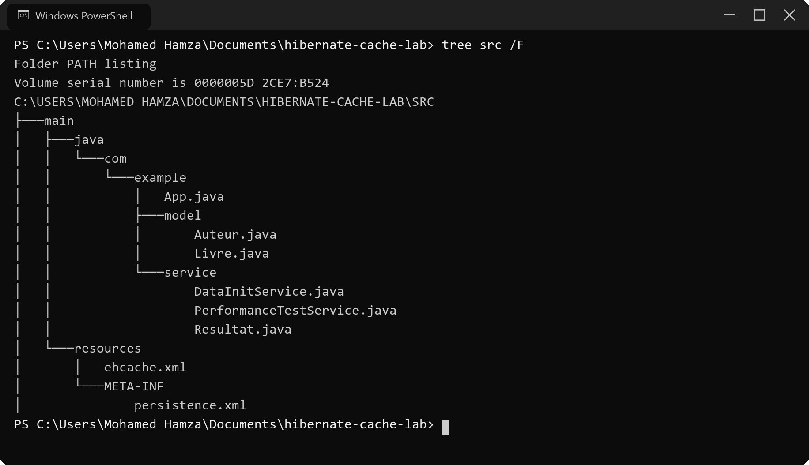
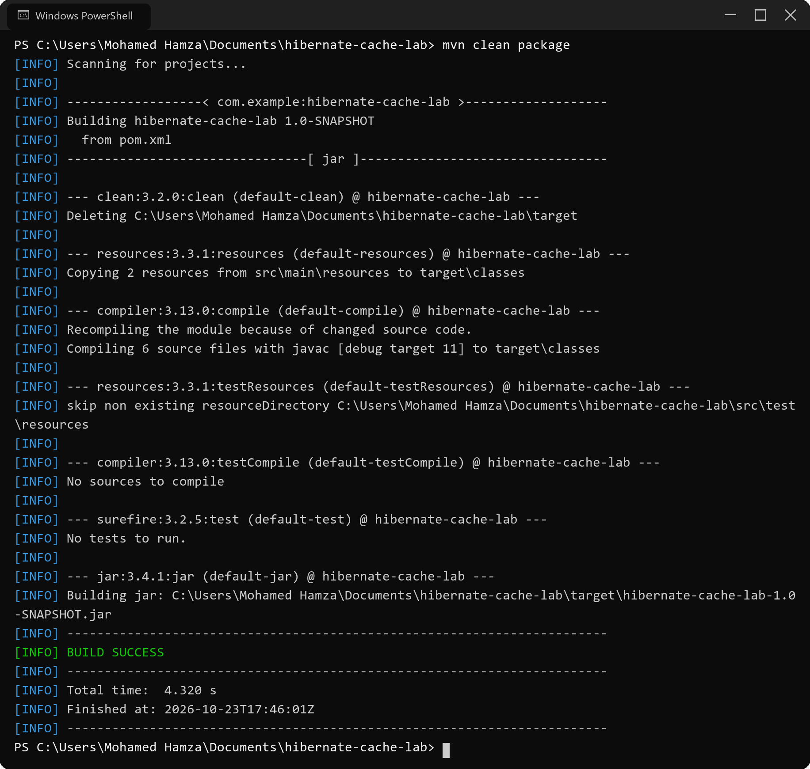
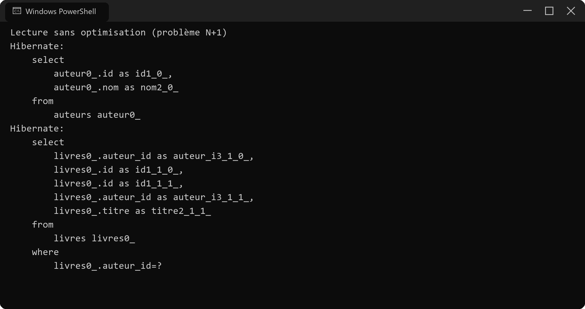
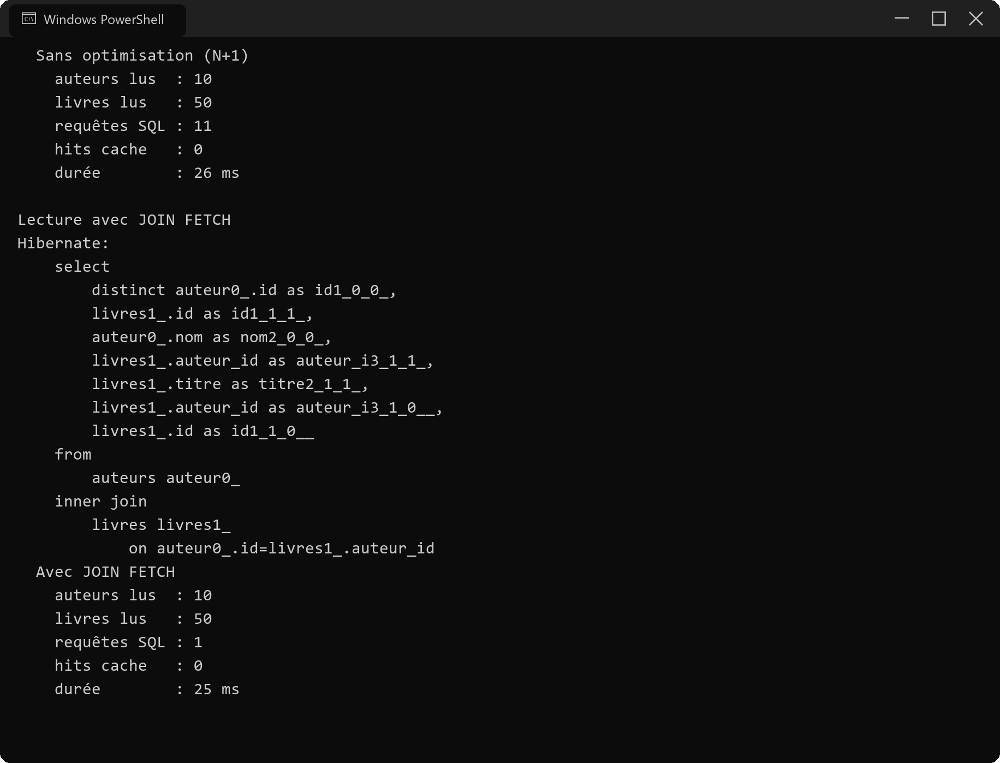
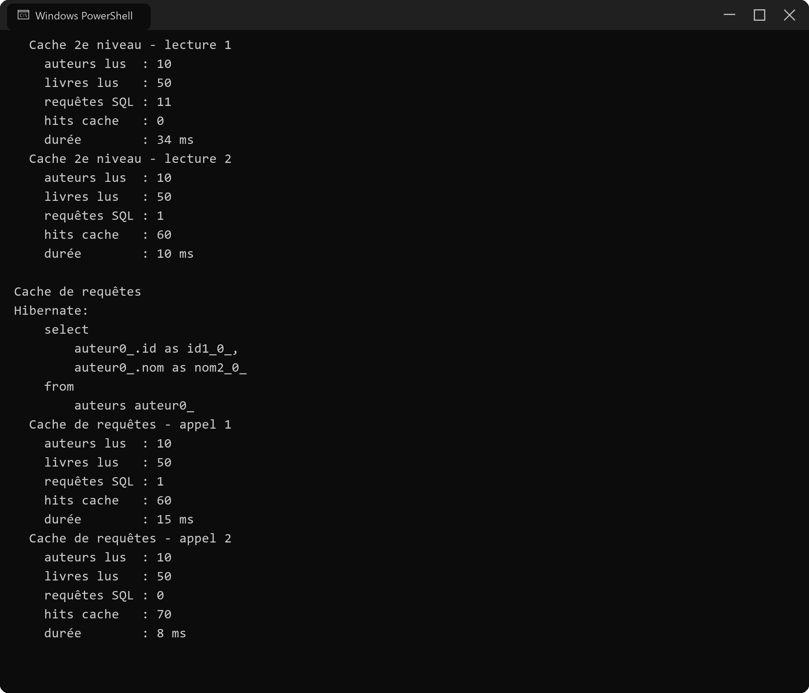
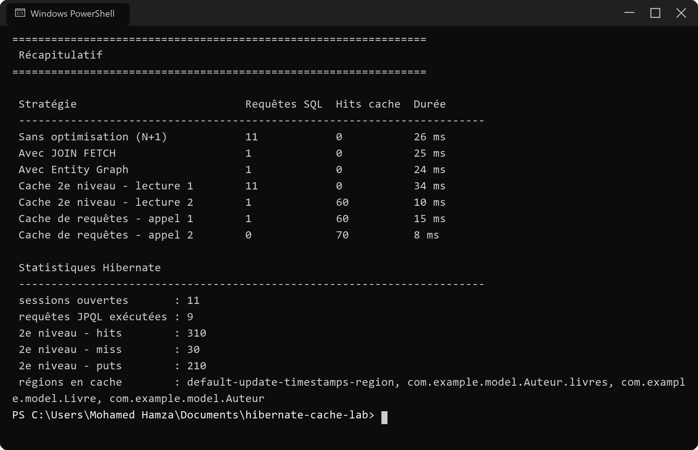

# TP 7 – Cache de second niveau, problème N+1 et Entity Graphs (Hibernate)

Projet Maven qui reprend le TP 7 du cours *Hibernate & JPA*. Le but est de charger la même
collection (`Auteur` → `Livre`) de plusieurs manières et de comparer, à chaque fois, le nombre
de requêtes SQL générées, les hits du cache de second niveau et le temps d'exécution.

Les données de test sont créées au démarrage : 10 auteurs et 5 livres par auteur (50 livres),
dans une base H2 en mémoire. Rien à installer côté base.

## Stack

- Java 11
- Hibernate ORM 5.4.32 (JPA 2.2, `javax.persistence`)
- EhCache 3.8.1 via JCache (`hibernate-jcache`)
- H2 1.4.200 (mémoire)
- Maven

## Structure du projet

```
hibernate-cache-lab/
├── pom.xml
├── logs/execution.log
├── screenshots/
└── src/main/
    ├── java/com/example/
    │   ├── App.java                     # point d'entrée : lance les 5 scénarios et affiche le bilan
    │   ├── model/Auteur.java            # @Cache + @NamedEntityGraph + collection de livres
    │   ├── model/Livre.java             # @Cache, ManyToOne LAZY
    │   └── service/
    │       ├── DataInitService.java     # jeu de données (10 auteurs / 50 livres)
    │       ├── PerformanceTestService.java
    │       └── Resultat.java
    └── resources/
        ├── ehcache.xml
        └── META-INF/persistence.xml
```

Ce que donne l'arborescence dans la console :



## Lancer le projet

```bash
mvn clean package
mvn -q compile exec:java
```

Le SQL est affiché par Hibernate (`hibernate.show_sql=true`). Si on veut juste les chiffres :

```bash
mvn -q compile exec:java -Dexec.args="--silent-sql"
```

`logs/execution.log` contient la sortie complète d'une exécution.



## Configuration

Dans `persistence.xml`, trois propriétés font tout le travail :

```xml
<property name="hibernate.cache.use_second_level_cache" value="true"/>
<property name="hibernate.cache.use_query_cache" value="true"/>
<property name="hibernate.cache.region.factory_class"
          value="org.hibernate.cache.jcache.JCacheRegionFactory"/>
<property name="hibernate.javax.cache.provider" value="org.ehcache.jsr107.EhcacheCachingProvider"/>
<property name="hibernate.generate_statistics" value="true"/>
```

`generate_statistics` sert uniquement à pouvoir lire les compteurs (`getPrepareStatementCount()`,
`getSecondLevelCacheHitCount()`) et mesurer les écarts entre deux lectures.

Les régions sont déclarées dans `ehcache.xml` : une par entité, une pour la collection
`Auteur.livres`, et deux pour les régions internes d'Hibernate.

## Les scénarios comparés

### 1. Requête simple → problème N+1

```java
TypedQuery<Auteur> query = em.createQuery("select a from Auteur a", Auteur.class);
List<Auteur> auteurs = query.getResultList();
for (Auteur auteur : auteurs) {
    nbLivres += auteur.getLivres().size();   // LAZY : une requête par auteur
}
```

`livres` est en `FetchType.LAZY`, donc Hibernate fait 1 requête pour les auteurs puis une
requête par auteur pour sa collection : 1 + N requêtes.



La requête sur `livres` est rejouée 10 fois (une par auteur), d'où les 11 requêtes du bilan.

### 2. JOIN FETCH

```java
TypedQuery<Auteur> query = em.createQuery(
        "select distinct a from Auteur a join fetch a.livres", Auteur.class);
```

Le `distinct` évite les doublons d'auteurs dans le résultat (un auteur revient autant de fois
qu'il a de livres avec un `inner join`).



Une seule requête, plus de N+1.

### 3. Entity Graph

L'association à charger est décrite sur l'entité :

```java
@NamedEntityGraph(name = "Auteur.livres",
        attributeNodes = @NamedAttributeNode("livres"))
```

puis appliquée à la requête par un hint :

```java
EntityGraph<Auteur> graph = (EntityGraph<Auteur>) em.createEntityGraph("Auteur.livres");
query.setHint("javax.persistence.fetchgraph", graph);
```

Même résultat que le JOIN FETCH (1 requête) mais sans toucher au JPQL : pratique quand la
requête est déjà écrite ailleurs ou générée dynamiquement.

### 4. Cache de second niveau

Les deux entités et la collection sont marquées `READ_WRITE` :

```java
@Cache(usage = CacheConcurrencyStrategy.READ_WRITE)
```

et le cache est vidé avant la mesure. La première lecture remplit le cache (11 requêtes),
la seconde est servie depuis le cache (1 requête, 60 hits) :



### 5. Cache de requêtes

Il faut en plus marquer la requête comme cachable :

```java
query.setHint("org.hibernate.cacheable", Boolean.TRUE);
```

Le second appel ne génère alors plus aucune requête SQL (0 requête, 70 hits).

## Bilan



| Stratégie                       | Requêtes SQL | Hits cache | Durée  |
|---------------------------------|--------------|------------|--------|
| Sans optimisation (N+1)         | 11           | 0          | 26 ms  |
| Avec JOIN FETCH                 | 1            | 0          | 25 ms  |
| Avec Entity Graph               | 1            | 0          | 24 ms  |
| Cache 2e niveau – lecture 1     | 11           | 0          | 34 ms  |
| Cache 2e niveau – lecture 2     | 1            | 60         | 10 ms  |
| Cache de requêtes – appel 1     | 1            | 60         | 15 ms  |
| Cache de requêtes – appel 2     | 0            | 70         | 8 ms   |

Les temps bougent d'une exécution à l'autre (JIT, machine), c'est surtout la colonne
« Requêtes SQL » qui est parlante : 11 → 1 → 0.

## Pièges rencontrés

Quelques points qui m'ont coûté du temps, notés ici au cas où :

- **`hibernate-ehcache` ne suffit pas avec EhCache 3.** La configuration du TP utilise
  `JCacheRegionFactory`, qui vient de `hibernate-jcache`. Avec `hibernate-ehcache` la propriété
  `hibernate.cache.region.factory_class` ne se résout pas.
- **L'ordre des éléments dans `ehcache.xml` n'est pas libre.** Dans un `<cache>`, `expiry` doit
  venir avant `resources`, et `heap` est un enfant de `resources`. Sinon EhCache refuse le
  fichier (`SAXParseException: cvc-complex-type.2.4.a`).
- **Les régions internes ont des noms imposés** : `default-update-timestamps-region` et
  `default-query-results-region`. Avec les anciens noms (`org.hibernate.cache.internal.StandardQueryCache`),
  Hibernate crée les caches à la volée et logue `HHH90001007`.
- **Le provider JCache ne lit pas `hibernate.javax.cache.uri` tout seul** : il faut lui passer
  explicitement l'URL du fichier (`EhcacheCachingProvider` crée alors les régions manquantes avec
  la configuration par défaut, d'où les warnings `HHH90001006`).
- **`emf.getCache().evictAll()` ne vide que les régions d'entités**, pas la collection. Pour
  repartir d'un cache vraiment vide il faut passer par
  `emf.unwrap(SessionFactory.class).getCache().evictAllRegions()`.
- **`Statistics.clear()` casse les mesures.** Après un `clear()`, `getPrepareStatementCount()`
  repart de zéro et on ne peut plus calculer un écart fiable entre le début et la fin d'une
  lecture. J'ai donc gardé les compteurs cumulatifs et fait la différence avant/après.

## Conclusion

Le N+1 est bien visible sur 10 auteurs (11 requêtes au lieu d'une), et les deux façons de le
corriger donnent le même résultat. Le cache de second niveau ne remplace pas une requête mal
écrite : il évite de relire ce qui a déjà été lu, ce qui se voit surtout sur la deuxième lecture
et sur les requêtes marquées `cacheable`.
